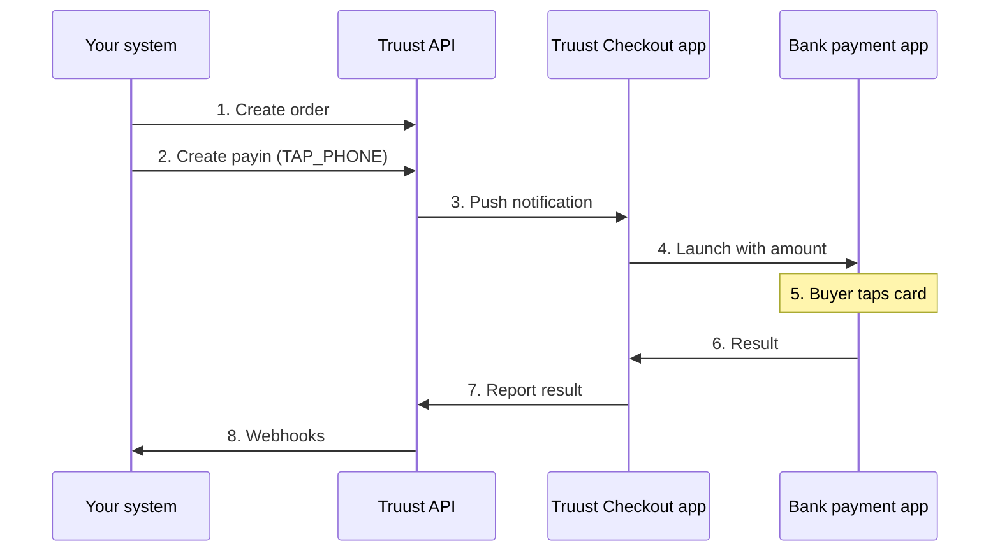

> Accept in-person card payments on Android devices using the merchant's own acquiring bank, while orders, statuses and webhooks are managed through the Truust API.

---

## Overview

Truust supports **card-present** (in-person) payments through the `TAP_*` payin types. Instead of sending the buyer a payment link, the merchant collects the payment on site: the buyer taps their card (or phone/wallet) on an Android device and the result is reported back to Truust.

Truust never reads the card itself. The card is captured by the **acquiring bank's certified payment app** installed on the same Android device. The **Truust Checkout** app acts as the bridge: it receives the order from Truust, launches the bank app with the amount and the merchant credentials, and reports the result back to Truust. From that point the order follows the same lifecycle and webhooks as any online payment.

Each account (merchant) contracts its own card-present gateway directly with its bank, exactly as it does with an online gateway such as Redsys. An account can have online and card-present gateways at the same time, and decide for each order whether to send a payment link or collect it in person.

## Payment Methods

| Payin type | Name | Device | Description |
|---|---|---|---|
| `TAP_PHONE` | Smartphone TPV (Tap to Phone) | NFC-enabled Android smartphone | SoftPOS: the phone itself becomes the card terminal. The card is read through the phone's NFC by the bank's **Smartphone TPV** app. |
| `TAP_PAY` | Tap2Pay - TPV | Android payment terminal (smart POS) | The payment is collected on an Android card terminal through the bank's **In-Store Payment** service. |
| `TAP_DOJO` | Dojo Tap to Pay | NFC-enabled Android smartphone | SoftPOS through the **Dojo Pocket** app. |
| `TAP_ECOPAY` | Tap2Pay - Ecopay | — | Card-present payments acquired through Ecopay. |

<Note>
`TAP_PHONE` and `TAP_PAY` are the methods currently available for the Comercia (CaixaBank) acquiring network. Availability of every `TAP_*` type depends on your platform configuration. Contact Truust support to confirm which ones can be enabled for your accounts.
</Note>

<Warning>
Card-present payments are only supported on **Android**. The Truust Checkout app on iOS cannot launch the bank payment apps.
</Warning>

## How It Works



The Truust Checkout app and the bank payment app run on the same Android device.

1. Your system creates the **order** for the amount to collect, assigning it to the manager logged in on the device that will collect the payment.
2. Your system creates a **payin** with the card-present type. The payin is created in `CREATED` status and stays pending until the device reports a result.
3. Truust sends a push notification to the Truust Checkout app logged in as that manager.
4. The Truust Checkout app asks for confirmation and launches the bank payment app with the amount and the gateway credentials configured in the account.
5. The buyer taps their card on the device (and enters the PIN if requested).
6. The bank app returns the result to the Truust Checkout app.
7. The Truust Checkout app reports the result to Truust, which confirms or denies the payin.
8. Truust notifies your system through webhooks.

---

## Prerequisites

- A Truust account with the `TAP_*` type in its list of allowed gateways (see [Step 1](#step-1-allow-the-gateway-on-the-account)).
- Card-present credentials provided by the merchant's acquiring bank (merchant number, terminal number and activation code for `TAP_PHONE`).
- An Android device with:
  - The **Truust Checkout** app (provided by Truust as an APK, optionally with your own look & feel).
  - The bank payment app: **Smartphone TPV** for `TAP_PHONE`, the **In-Store Payment** service for `TAP_PAY`, or **Dojo Pocket** for `TAP_DOJO`.
  - NFC enabled (for `TAP_PHONE` and `TAP_DOJO`).
- A valid API token (see [Authentication](/developers)).

---

## Step 1: Allow the Gateway on the Account

A gateway type can only be created on an account if it is included in the account's `allowed_gateways`. You can set it when creating the account:

```bash
curl -X POST {{endpoint}}/2.0/accounts \
  -H "Accept: application/json" \
  -F name="Clinic Barcelona" \
  -F slug="clinic-bcn" \
  -F country_code="ES" \
  -F email="admin@clinic.example" \
  -F password="{password}" \
  -F "allowed_gateways[]=TAP_PHONE" \
  -F "allowed_gateways[]=TAP_PAY" \
  -F "allowed_gateways[]=REDSYS_V2"
```

You can check the current list in the account detail (`GET /2.0/accounts/me`).

## Step 2: Configure the Gateway

Register the credentials provided by the bank with `POST /2.0/accounts/gateways`. The gateway is linked to the account that owns the API token used in the `Authorization` header, so no account id is required.

```bash
curl -X POST {{endpoint}}/2.0/accounts/gateways \
  -H "Authorization: Bearer {token}" \
  -H "Accept: application/json" \
  -d type=TAP_PHONE \
  -d name="Smartphone TPV" \
  -d tapphone_merchant_id={merchant_number} \
  -d terminal_id={terminal_number} \
  -d tapphone_code={activation_code}
```

Fields required by each type:

| Payin type | Field | Bank / app name |
|---|---|---|
| `TAP_PHONE` | `tapphone_merchant_id` | Merchant number (*Número de comercio*) |
| | `terminal_id` | Terminal number (*Número de terminal*) |
| | `tapphone_code` | Activation code (*Código de activación*) |
| `TAP_PAY` | `tappay_merchant_id` | Merchant ID |
| `TAP_DOJO` | `key`, `secret` | Dojo credentials |
| `TAP_ECOPAY` | `tapecopay_merchant_id` | Merchant ID |

<Note>
For `TAP_PHONE` the Truust Checkout app registers the Smartphone TPV app automatically with these credentials the first time a payment is launched. The merchant does not need to log in manually in the bank app. If the credentials in the gateway are wrong, the payment will fail with a registration error even if the bank app has a session open.
</Note>

## Step 3: Create the Managers

The Truust Checkout app on each device logs in with a **manager** of the account. In a card-present integration, think of the manager as a **service account** rather than a specific employee: it is the identity the device uses to receive and report payments, not a person.

We recommend creating **one manager per device** (e.g. `reception-1@clinic.example`, `cabin-2@clinic.example`), so that each order can be sent to a specific device and its availability can be tracked individually.

```bash
curl -X POST {{endpoint}}/2.0/managers \
  -H "Authorization: Bearer {token}" \
  -H "Accept: application/json" \
  -d email="reception-1@clinic.example" \
  -d password="{password}"
```

The response returns the manager `uuid`, which you can use later to check whether the device is online (see [Device Availability](#device-availability)).

## Step 4: Create the Order

Create the order with `POST /2.0/orders` and send the `X-Truust-Manager` header with the email of the manager logged in on the device that will collect the payment. The order is assigned to that manager, and that device will receive the payment request.

```bash
curl -X POST {{endpoint}}/2.0/orders \
  -H "Authorization: Bearer {token}" \
  -H "Accept: application/json" \
  -H "X-Truust-Manager: reception-1@clinic.example" \
  -d name="Treatment #1234" \
  -d value=45.00 \
  -d auto_settle=1
```

## Step 5: Create the Payin

Create the payin with the card-present type:

```bash
curl -X POST {{endpoint}}/2.0/payins \
  -H "Authorization: Bearer {token}" \
  -H "Accept: application/json" \
  -d order_id={order_id} \
  -d type=TAP_PHONE
```

The payin is created in `CREATED` status. The device logged in as the manager assigned to the order receives a push notification, shows the payment details and, once accepted, opens the bank payment app so the buyer can tap their card.

<Note>
The payment can also be retried from the order detail in the Truust Checkout app, for example if the device was offline when the push notification was sent.
</Note>

## Step 6: Receive the Result

The bank app applies a **timeout of 40 seconds** for the buyer to present the card. After that, every payin ends in one of two final states, and Truust notifies you through webhooks:

| Result | Payin status | Webhook events |
|---|---|---|
| Payment approved | `CONFIRMED` | `App\Events\Payin\PayinConfirmed` + `App\Events\Escrow\EscrowPublished` |
| Declined card, timeout, app closed or connection lost | `DENIED` | `App\Events\Payin\PayinDenied` + `App\Events\Escrow\EscrowFailed` |

- **Confirmed** means the payment has been registered correctly and the order can be considered paid.
- **Denied** means there was an error or a timeout. The order remains open and a new payin can be created to try again.

When the payin is confirmed, the masked card number used in the payment is available in the payin detail.

---

## Refunds

Card-present refunds also require the card to be **physically present**, and it must be the **same card** used for the original payment.

1. Request the refund through the API with [`POST /2.0/payins/{id}/refund`](/api-reference/refund-payin), or from the order detail in the Truust Checkout app.
2. The refund is created in `CREATED` status and Truust sends a push notification to the device logged in as the manager assigned to the order.
3. The Truust Checkout app opens the bank payment app in refund mode, with the original transaction reference.
4. The buyer taps the same card. The 40-second timeout also applies.
5. The device reports the result and Truust notifies you.

| Result | Refund status | Webhook events |
|---|---|---|
| Refund requested | `CREATED` | `App\Events\Refund\RefundCreated` |
| Refund completed | `CONFIRMED` | `App\Events\Refund\RefundConfirmed` + `App\Events\Escrow\EscrowCancelled` |
| Refund declined or timeout | `DENIED` | `App\Events\Refund\RefundDenied` (the order does not change) |

## Webhooks

For a card-present integration we recommend subscribing at least to the following events (see [Webhooks](/developers#webhooks)):

| Event | Meaning |
|---|---|
| `App\Events\Escrow\EscrowPublished` | Payment confirmed: the order is paid |
| `App\Events\Escrow\EscrowFailed` | Payment denied or timed out: retry if needed |
| `App\Events\Refund\RefundDenied` | Refund could not be completed |
| `App\Events\Escrow\EscrowCancelled` | Refund confirmed: the order is cancelled |

The payload includes the account the order belongs to, so a single endpoint can serve all your accounts. If you manage many accounts under the same platform, Truust can configure your webhook URLs at platform level so that every new account sends notifications automatically.

## Device Availability

Since card-present payments are synchronous, it is useful to know whether the collecting device is available before sending a payment to it.

While the manager is logged in on the device and the Truust Checkout app is in the **foreground**, the app reports a heartbeat to Truust **every minute**. The last heartbeat is available in the `last_alive` property of the manager (`YYYY-MM-DD hh:mm:ss`):

```bash
curl {{endpoint}}/2.0/managers/{uuid} \
  -H "Authorization: Bearer {token}" \
  -H "Accept: application/json"
```

If `last_alive` is older than ~2 minutes, consider the device unavailable (phone off, app closed or in the background, no connectivity) and show an error to your user instead of sending the payment.

---

## Sandbox

- Truust provides a sandbox APK of the Truust Checkout app and test gateway credentials for the bank app.
- Without physical test cards, the bank's card simulator app can be used. Simulated cards can occasionally fail; if so, try again with another test card.
- To complete a refund in sandbox, use the same test card used for the payment.

## Troubleshooting

| Situation | Cause | Action |
|---|---|---|
| "App is not installed" / "not enabled" | The bank payment app is missing or disabled on the device | Install or enable the bank app (Smartphone TPV, In-Store Payment or Dojo Pocket) |
| Registration / login error | Wrong `merchant_id`, `terminal_id` or activation code in the gateway | Check the gateway credentials against the bank's onboarding data |
| Errors `912`, `014`, `104` (Smartphone TPV) | The Smartphone TPV app is not available | Check that the app is installed, up to date and registered |
| Payment denied after ~40 seconds | The card was not presented in time | Create a new payin and try again |
| No push notification on the device | The device is not logged in as the manager, the order was not assigned with `X-Truust-Manager`, or the device has no connectivity | Check `last_alive` and retry from the order detail in the app |
| The payment option is not shown | The account has no `TAP_*` gateway configured | Complete [Step 2](#step-2-configure-the-gateway) |
