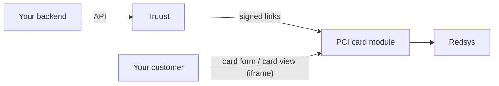

> Take card payments in a card form with your own look, keep the card for later and show it back to your customers. Truust keeps everything that handles card data in a dedicated PCI module, deployed in a PCI DSS certified environment, so your integration only deals with ids and links.

---

## Overview

Card numbers are the most regulated data in payments. Whoever receives them enters PCI DSS scope, with its audits and controls. That is why Truust isolates card handling in its own component: the PCI card module, a small service deployed in a PCI DSS certified infrastructure, separate from the rest of the platform. It is the **only** part of Truust that ever sees a card number.

Everything else stays as you know it. You create orders and payins with the regular API, Truust decides every step of the payment, and the module only captures the card, talks to the gateway and, when you ask for it, keeps the card safe.

| What you get | How |
|---|---|
| A card form instead of the bank's page | The module serves the form, instead of redirecting the customer to the bank's payment page |
| Your look and feel | You customize the form template. The form is always served from a Truust domain, which keeps your site out of PCI scope |
| 3-D Secure handled for you | The bank challenge runs inside the same iframe |
| Saved cards you can show again | An embeddable iframe that displays the card to its owner |
| Card data for PCI certified partners | A single-use link that returns the card in JSON |

<Note>
The module currently works with **Redsys** payments (`REDSYS_V2`). Other gateways and card issuers will use the same model.
</Note>

---

## How It Fits



- **Your backend** talks only to the Truust API: orders, payins, cards.
- **Truust** decides what happens at each step and signs every link to the module. Links are short-lived and cannot be forged or reused across Accounts.
- **The PCI card module** shows the form, receives the card, sends it to the gateway and, if asked to, stores it encrypted.
- **Your customer** types the card, and later sees it, inside iframes served by the module.

Card numbers and CVCs travel only between the customer's browser, the module and the gateway. They stay inside the PCI module: they never reach your servers, nor the rest of the Truust platform, its API or its logs.

---

## Enabling It

The module is enabled **per Account and per gateway**. The Truust team switches the Account's Redsys gateway to PCI mode; nothing changes in your integration. From then on, every `REDSYS_V2` payin of that Account uses the module's card form instead of the classic redirect to the bank.

At the same time, the Truust team configures for the Account:

| Setting | What it controls |
|---|---|
| Form template | The look of the card form: your colours, fonts and layout. |
| Allowed domains | Which websites may embed the card form and the card view. Any other site is blocked by the browser. |

The template changes how the form looks, not where it lives: the form and the card view are always served from a Truust domain, inside an iframe on your page. That is what keeps the card data away from your site.

Contact the Truust team to enable it on your Account.

---

## Taking a Payment

The payment flow is the regular one. Create the order and the payin:

```bash
curl -X POST {{endpoint}}/2.0/payins \
  -H "Authorization: Bearer {token}" \
  -H "Content-Type: application/json" \
  -d '{ "order_id": 1234, "type": "REDSYS_V2" }'
```

The payin comes back with a `direct_link`: the checkout page where the customer pays. Open it, or embed it in your own page:

```html
<iframe src="{direct_link}" width="100%" height="550" frameborder="0" allow="payment"></iframe>
```

Inside, the customer sees the module's card form. On submit, the module sends the card to Redsys and, if the bank asks for it, runs the 3-D Secure challenge in the same iframe. When it is done, the customer is sent to your success or failure URL, and you receive the usual payin webhooks.

### Sizing the iframe

The form tells its parent page how tall it is, so you can avoid scrollbars. Listen for the message and resize your iframe:

```javascript
window.addEventListener('message', function (event) {
  var data = typeof event.data === 'string' ? JSON.parse(event.data) : event.data;

  if (data && data.iframe && data.iframe.height) {
    document.getElementById('checkout').style.height = data.iframe.height;
  }
});
```

The message has the shape `{ "iframe": { "height": "620px", "width": "100%" } }`.

---

## Saving the Card

To keep the card for later, create the payin with `save_card`:

```bash
curl -X POST {{endpoint}}/2.0/payins \
  -H "Authorization: Bearer {token}" \
  -H "Content-Type: application/json" \
  -d '{ "order_id": 1234, "type": "REDSYS_V2", "save_card": 1 }'
```

The payin is linked to a card record of the customer. When the payment goes through, the card is saved twice, each copy for a different purpose:

| Where | What | Used for |
|---|---|---|
| Redsys | A token | Charging the card again, as with any saved card |
| PCI card module | The card number, expiry and cardholder, encrypted | Showing the card again |

The CVC is **never** stored, as PCI DSS requires. The stored card is deleted automatically when it expires.

---

## Showing the Card

Retrieve the card with the [Get card endpoint](/api-reference/get-card). If the card was saved through the module and the payment was confirmed, the response includes two extra links:

```json
{
  "uuid": "...",
  "alias": "0003",
  "confirmed": true,
  "card_url": "https://.../card?ctx=...&sig=...",
  "card_json_url": "https://.../card.json?ctx=...&sig=..."
}
```

| Field | What it is | Valid for |
|---|---|---|
| `card_url` | An embeddable page that shows the card number, expiry and cardholder | 15 minutes |
| `card_json_url` | The same data in JSON, for PCI DSS certified partners | 4 minutes, **single use** |

Both links are signed for your Account: a card can only be read through links generated for the Account that owns it. Ask for them right before you use them, and never store them.

### The card view iframe

Embed `card_url` where your customer should see the card, for example in their profile:

```html
<iframe src="{card_url}" width="100%" height="220" frameborder="0"></iframe>
```

The card is shown inside the module's page, so the number goes straight from the PCI environment to your customer's screen. Your page only holds the iframe, in the same way Stripe Issuing shows its cards with secure elements. As with the card form, only your allowed domains can embed it.

### Card data in JSON

If your company is PCI DSS certified and needs the card itself, for example to pass it to another provider, call `card_json_url` from your backend:

```bash
curl "{card_json_url}"
```

```json
{
  "pan": "4548810000000003",
  "expiry_month": "07",
  "expiry_year": "2030",
  "cardholder": "Jane Doe"
}
```

The link works **once**: a second call returns `403`. Request a fresh card from the Get card endpoint whenever you need the data again.

<Warning>
Receiving the card number puts your systems in PCI DSS scope. Only use `card_json_url` if your company is PCI DSS certified, and never log, store or forward the response outside that scope.
</Warning>

---

## Notes

- Full card numbers stay inside the PCI module. Everywhere else, including the regular Truust API, cards are identified by their `uuid` and their last four digits in `alias`.
- `card_url` and `card_json_url` only appear when you retrieve a single card, never in card lists.
- A card is shown only after its payment is confirmed. Cards from declined payments are never exposed.
- Saving a card through the module needs `save_card` on the payin; payins without it store nothing.
- For cards issued by Truust, see [Card Issuing](/guides/card-issuing).
